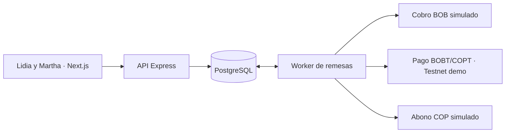

# DeOne

Wallet web de remesas Bolivia → Colombia. Plan de hackathon para cinco desarrolladores en 12 horas.
testeand update

## Arranque del monorepo

Requiere Node.js **22.14 o superior** y npm. Desde la raíz, en Windows:

```powershell
npm.cmd ci
npm.cmd run dev
```

Abrir la [wallet local](http://localhost:3000). La web redirige `/api/*` al backend local en el puerto 4000. El [endpoint de salud](http://localhost:3000/api/health) muestra el modo Stellar. En macOS o Linux, usar `npm` en lugar de `npm.cmd`.

| Ruta | Contenido |
| --- | --- |
| [`apps/frontend`](apps/frontend) | Next.js con App Router, dashboard, formulario de remesa y seguimiento. CSS con tokens compartidos y Roboto Condensed servido desde la aplicación. |
| [`apps/backend`](apps/backend) | API Express en TypeScript, wallets de demo, orquestación de remesas, rampas simuladas y adaptadores Stellar. |
| [`packages/contracts`](packages/contracts/src/index.ts) | Tipos de perfiles, saldos, cotizaciones, errores y remesas que comparten ambos workspaces. |
| [Tablero de módulos](docs/modulos.md) | Dueños, archivos, tareas, entregas y criterios de aceptación para los cinco roles. |
| [Guía visual](docs/estilos.md) | Paleta, tipografía, componentes y revisión en móvil y escritorio. |

La base funciona con **fiat y Stellar simulados** al arrancar. Inicia sesión con `user1` / `user1pass` (Lidia, BOB) o `user2` / `user2pass` (Martha, COP). Las sesiones y los datos de demo se reinician al detener el backend. El adaptador Testnet está disponible por configuración. El siguiente hito del backend es persistir la remesa y la cola en PostgreSQL.

`npm run dev:frontend` y `npm run dev:backend` levantan cada servicio por separado. `npm run check` verifica tipos, `npm test` ejecuta las pruebas del backend y `npm run build` compila ambos servicios. Para ejecutar la compilación, usar `npm run start -w @deone/backend` y `npm run start -w @deone/frontend` en dos terminales.

### Variables de entorno

El modo simulado arranca sin `.env`. Para activar Testnet, copiar [la plantilla del backend](apps/backend/.env.example) a `apps/backend/.env` y completar solo las credenciales de prueba.

| Variable | Valor esperado |
| --- | --- |
| `STELLAR_MODE` | `simulated` por defecto. Usar `testnet` para mover los activos de prueba BOBT y COPT en Stellar Testnet. |
| `WALLET_USER1_SECRET` · `WALLET_USER2_SECRET` | Semillas de las wallets de Lidia (BOB) y Martha (COP) en Testnet. Las genera `npm run setup:assets`. |
| `STELLAR_ASSET_ISSUER_SECRET` | Emisor de `BOBT` y `COPT`. Solo para emitir saldo de prueba. |
| `STELLAR_TREASURY_SECRET` | Tesorería: recibe el cobro en la moneda de origen y paga la moneda de destino. |
| `DEMO_PAYOUT_RESULT` | `success` por defecto. Cambiar a `failed` para probar revisión y ausencia de abono. |
| `PORT` y `HOST` | `4000` y `127.0.0.1` por defecto. Ajustar para el entorno de ejecución. |
| `BACKEND_URL` | Solo si cambia la URL de la API. Copiar [la plantilla del frontend](apps/frontend/.env.local.example) a `apps/frontend/.env.local` antes de arrancar o compilar la web. |

Hacer commit de las plantillas y de `package-lock.json`. Las variables reales, dependencias instaladas, compilaciones y reportes de pruebas quedan ignorados por Git.

## Decisión técnica

**Construir una remesa de extremo a extremo con USDC en Stellar Testnet y ambos tramos fiat simulados.** Lidia confirma un envío en BOB y Martha ve el abono de prueba en COP. El comprobante enlaza al pago en Testnet y separa esa confirmación del abono simulado. Para la demo, usar dos perfiles precargados y un único corredor BOB → COP.

Para mover dinero real, hacen falta un proveedor que cobre BOB y entregue USDC en Stellar y otro que reciba ese USDC y desembolse COP a la beneficiaria. Stellar liquida el tramo USDC. DeOne coordina los tres pasos y muestra su estado.

| Pieza | Qué verificar |
| --- | --- |
| Entrada Bolivia | **alyto** publica conversión BOB ↔ USDC en Stellar, cobros por QR y un anchor con SEP-10/12/24/31. Validar acceso de integrador y que el depósito SEP-24 permita cobrar BOB por el medio elegido, entregar USDC al destino del flujo y consultar su estado. La oferta de su wallet para consumidores y la API del anchor se validan por separado. [alyto](https://alyto.io/) |
| Salida Colombia | **VANK** documenta USDC en Stellar → COP por llave Bre-B, con SEP-6 para API, SEP-24 interactivo y SEP-38 para cotización firme. Publica un sandbox en Stellar Testnet y un mínimo de retiro de **1 USDC**. Confirmar alta comercial, datos de ordenante y beneficiaria, comisiones y confirmación final antes de lanzar. [Guía de integración de VANK](https://vank.co/en/anchor-stellar) |
| Pollar | SDK opcional para login, wallets, firma y rampas. Su README documenta BOB vía Stereum + CCTP bajo Solana. Antes de usarlo como rampa de origen, verificar con `getRampRoutes` y una cotización que el resultado sea **USDC en Stellar**, en la dirección, entorno y monto requeridos. Mantenerlo fuera de la ruta crítica de la demo. [SDK oficial de Pollar](https://github.com/pollar-xyz/pollar) |

**SEP-24** sirve para un depósito o retiro con formulario alojado por el anchor. **SEP-6** expone el flujo por API, con los pasos de usuario que pida el proveedor. **SEP-31** encaja si una entidad de origen y un anchor receptor acuerdan operar la remesa directamente. **SEP-38** cotiza la conversión cuando el proveedor lo admite. Para un piloto automatizado, evaluar cobro confirmado en Bolivia y payout API en Colombia con beneficiaria registrada. [Guía de Stellar sobre rampas y pagos transfronterizos](https://stellar.org/blog/ecosystem/fiat-on-off-ramps-and-cross-border-payments-on-stellar) · [SEP-38](https://github.com/stellar/stellar-protocol/blob/master/ecosystem/sep-0038.md)

**Bs 10 es el monto del ejemplo de demo.** En vivo, validar el mínimo de entrada y que el USDC neto después de comisiones cumpla el mínimo de salida. Si la cotización no pasa esos controles, mostrar el mínimo aplicable antes de iniciar el cobro. [Límites de VANK](https://vank.co/en/anchor-stellar)

## Arquitectura del MVP

Un repositorio en TypeScript con **Next.js** y CSS con tokens para la web, **Express** para la API y un paquete de contratos compartidos. La arquitectura objetivo usa **PostgreSQL** para el estado y una tabla de trabajos, y un **worker Node.js** que consume los trabajos y llama a `PayInProvider`, `StellarRail` y `PayOutProvider`. En la base actual el proceso de la API ejecuta una cola en memoria. El perfil activo sale de la sesión iniciada con `POST /api/auth/login`: la cookie httpOnly `deone_session` identifica a Lidia o a Martha. No hay selector de perfil por `POST /api/demo/profile`.



### Flujo que debe verse en pantalla

1. Lidia abre **Pago**, elige a Martha por alias y escribe `Bs 10,00`. La cotización de demo muestra **Bs 0,50 de comisión incluida**, **$4.500 COP netos** y su vencimiento. Es una tarifa ficticia de prueba.
2. Lidia confirma. La API reserva Bs 10 del saldo de prueba, crea la remesa y encola el cobro simulado en la misma transacción de base de datos. Al confirmarse el cobro simulado, la reserva se convierte en débito.
3. Con `STELLAR_MODE=testnet`, el adaptador actual mueve activos propios de la demo, no USDC. La wallet del ordenante paga **BOBT** a la tesorería y la tesorería paga **COPT** a la wallet del destinatario. Para Bs 10,00 el cobro on-chain es `10.00` BOBT y el abono es `4500.00` COPT. El diseño anterior, que se mantiene para el piloto con anchors, envía **1,20 USDC de prueba** desde una cuenta de liquidación a una cuenta de destino, con trustline al emisor de USDC de Testnet y fondeo desde Circle. Ese tramo USDC no lo ejecuta el adaptador de BOBT/COPT. [Stellar para desarrolladores](https://developers.stellar.org/) · [USDC en Stellar](https://www.circle.com/multi-chain-usdc/stellar) · [Faucet de Circle](https://faucet.circle.com/)
4. Tras confirmar el pago en Stellar, el adaptador de salida confirma el abono de demo. El worker acredita $4.500 COP en la cuenta ficticia de Martha, registra el movimiento y cierra la remesa en una sola transacción de base de datos. El pago on-chain es verificable en Testnet y el movimiento COP es una anotación de demo. En el piloto con Bre-B, el dinero llega a la cuenta bancaria asociada a la llave y la app refleja el desembolso en el historial.

### Contrato de la API

Los tipos viven en [`packages/contracts/src/index.ts`](packages/contracts/src/index.ts). Los montos fiat van en unidades menores con escala 2: `1000` es Bs 10,00 y `450000` es $4.500 COP. La sesión y la cotización fijan titular, destinataria y montos en el servidor. El cuerpo de error es `{ code, message }`.

| Operación | Contrato |
| --- | --- |
| `GET /api/health` | Público. Devuelve `{ status: "ok", mode: "demo", stellarMode }`. |
| `POST /api/auth/login` | Recibe `{ username, password }`. `user1` / `user1pass` abre a Lidia y `user2` / `user2pass` abre a Martha. Responde la `Wallet` y fija la cookie httpOnly `deone_session` (`SameSite=Lax`, 8 horas). |
| `POST /api/auth/logout` | Cierra la sesión de la cookie y responde `{}`. |
| `GET /api/wallet` | Requiere sesión. Devuelve perfil, moneda, `availableMinor` y movimientos. |
| `GET /api/stellar/wallet` | Requiere sesión. Devuelve dirección, existencia de la cuenta, saldos y `network: "testnet"`. En Testnet los activos de la demo son **BOBT** y **COPT**. |
| `POST /api/quotes` | Requiere sesión. Recibe `recipientAlias` y `sendAmountMinor`. Devuelve `id`, ordenante, destinataria, monto enviado, comisión incluida, monto neto, `expiresAt` (2 minutos) y `mode: "demo"`. El corredor vale en ambos sentidos. |
| `POST /api/remittances` | Requiere sesión. Recibe `{ quoteId }` y la cabecera `Idempotency-Key` (1 a 100 caracteres). La web usa el `quoteId` como clave. Devuelve la remesa con `id`, `status`, `stellarMode`, `createdAt` y, cuando existen, `txHash` y `payoutTxHash`. |
| `GET /api/remittances/:id` | Devuelve la misma remesa para el seguimiento. La UI consulta cada 2–3 segundos durante el envío. Esta lectura no exige sesión. |

**Idempotencia** La misma clave, el mismo ordenante y la misma cotización devuelven la remesa ya creada. La misma clave con otra cotización responde `KEY_REUSED`. La misma clave de otro usuario responde `SENDER_REQUIRED`. Cada cotización se consume una vez (`QUOTE_USED`). Una cotización vencida o desconocida responde `QUOTE_EXPIRED` y no reserva saldo.

**Estados** `AWAITING_PAYIN → PAYIN_CONFIRMED → STELLAR_PENDING → STELLAR_CONFIRMED → PAYOUT_PENDING → COMPLETED`. `FAILED` es un fallo definitivo sin fondos pendientes. `REVIEW_REQUIRED` cubre fondos en tránsito o un resultado incierto. `COMPLETED` exige la confirmación del adaptador de desembolso, aunque el hash ya exista. `txHash` es el pago del ordenante a la tesorería. `payoutTxHash` es el pago de la tesorería al destinatario.

| Código | HTTP | Cuándo |
| --- | --- | --- |
| `INVALID_JSON` | 400 | El cuerpo no es JSON. |
| `INVALID_QUOTE` | 400 | Faltan `recipientAlias` o `sendAmountMinor`, o no tienen el tipo esperado. |
| `INVALID_CONFIRMATION` | 400 | Faltan `quoteId` o `Idempotency-Key`, o la clave supera 100 caracteres. |
| `INVALID_CREDENTIALS` | 401 | Usuario o contraseña incorrectos. |
| `UNAUTHORIZED` | 401 | La operación exige sesión y no hay una vigente. |
| `SENDER_REQUIRED` | 403 | La cotización, o la clave de idempotencia, pertenece a otro usuario. |
| `UNSUPPORTED_ROUTE` | 422 | El alias no existe o la ruta no cambia de moneda. |
| `INVALID_AMOUNT` | 422 | El monto queda fuera de rango. BOB: Bs 1,00 a Bs 100,00. COP: $5.000 a $100.000. |
| `QUOTE_EXPIRED` | 409 | La cotización no existe o ya venció. |
| `QUOTE_USED` | 409 | La cotización ya se confirmó. |
| `KEY_REUSED` | 409 | La clave de idempotencia ya pertenece a otra cotización. |
| `INSUFFICIENT_BALANCE` | 409 | El saldo disponible no cubre el envío. |
| `NOT_FOUND` | 404 | No existe esa remesa. |
| `INTERNAL_ERROR` | 500 | Fallo no clasificado. |

**Datos mínimos** `demo_accounts`, `quotes`, `remittances`, `wallet_entries` y `jobs`. Registrar hash, referencias de proveedor, estado y marcas de tiempo en la remesa. El adaptador de demo envía **BOBT** o **COPT** al SDK como string decimal de dos posiciones (`10.00`, `4500.00`). El diseño de producción con **USDC** usa el mismo formato decimal, pero ese activo no circula en el adaptador actual.

**Reintentos** Usar restricciones únicas para cotización consumida, clave de idempotencia por ordenante y movimiento por remesa y tipo. Reservar o acreditar saldo bajo transacción. El worker procesa un pago Stellar a la vez desde la cuenta de prueba. Persistir el XDR firmado con vencimiento y el hash antes de enviar. Si la respuesta es incierta, consultar el hash y reenviar el mismo XDR mientras sea válido. Si persiste la incertidumbre, enviar a revisión. Liberar una reserva si falla el cobro antes del débito. En el piloto, verificar firmas de webhooks y conciliar por identificador antes de reintentar un pago externo.

**Entornos** Fiat simulado en ambos modos. `STELLAR_MODE=testnet` mueve BOBT y COPT en la red de pruebas y lee las semillas solo del servidor. El diseño con USDC de Circle queda para el piloto con anchors, fuera de este adaptador. Si se prueba VANK por separado, confirmar que su sandbox acepta el emisor configurado y usar la cuenta y el memo que devuelva el anchor para esa orden. [Datos de sandbox de VANK](https://vank.co/en/anchor-stellar)

## UI web basada en las capturas

Usar el mismo componente para los dos perfiles, con bandera y formato local `es-BO` o `es-CO`. Paleta aproximada de la referencia. Los importes de las capturas sirven para ilustrar la jerarquía visual y la base de datos de demo controla el saldo mostrado.

| Elemento | Implementación |
| --- | --- |
| Color | Fondo `#0D0D0D`, tarjetas `#151515`, líneas `#3A3A3A`, amarillo `#FFD000`, texto `#F7F7F7`, secundario `#B8B8B8`, abono `#72D654`, débito `#FF5353`. Acompañar el color con signo y texto. |
| Encabezado y saldo | Marca DeOne, nombre, bandera, alias o número de cuenta ficticio copiable. Tarjeta con borde amarillo, saldo grande, botón para ocultarlo y etiqueta persistente **Modo demo**. |
| Acciones | Tres botones amarillos como en las capturas. **Cobro** muestra el alias y permite copiarlo. **Pago** abre la remesa. **Retiro** se muestra deshabilitado con «Próximamente». |
| Actividad | «Últimos movimientos» muestra concepto, fecha, monto y estado. «Ver todos» lleva a **Movimientos**. En el detalle aparecen el comprobante y, cuando existe, el enlace a Stellar Testnet. |
| Navegación | **Inicio · Servicios · Movimientos · Más**. Inicio y Movimientos son funcionales. Más muestra la sesión activa y permite cerrarla. El cambio de perfil se hace con login y logout. Servicios queda como acceso futuro. En móvil, barra inferior. En escritorio, la misma jerarquía en un contenedor centrado con espacio lateral. |

Pantallas imprescindibles `Inicio → Pago → Revisar cotización → Seguimiento/comprobante`, más historial y vista de Martha. Dejar para después el escáner de cámara, QR bancario real, pagos de servicios, retiro manual, registro abierto y corredores adicionales.

## Reparto para cinco desarrolladores

| Responsable | Módulo y propiedad | Entrega comprobable |
| --- | --- | --- |
| **Dev 1 · UI wallet** | `apps/frontend/src/wallet` y `src/styles` del frontend. Tokens, saldo, perfiles, botones, historial y responsive. | A la H4 valida ambas vistas. A la H8 demuestra el abono actualizado. |
| **Dev 2 · UI remesa** | `apps/frontend/src/remittances` y rutas de pago y remesas. Alias, monto, cotización, seguimiento, errores y comprobante. | A la H4 valida el flujo simulado. A la H8 demuestra el enlace al hash cuando Testnet está configurada. |
| **Dev 3 · Backend y datos** | `apps/backend/src/index.ts`, `src/remittances` y contratos. PostgreSQL, idempotencia, saldo y worker durable. | A la H4 crea una remesa persistente. A la H7 puede reiniciar el proceso y consultar el envío sin duplicar el movimiento. |
| **Dev 4 · Stellar** | `apps/backend/src/stellar`. Cuentas Testnet, trustlines, fondeo y conciliación por hash con Dev 3. | A la H3 obtiene el primer hash. A la H7 valida la recuperación de una confirmación pendiente. |
| **Dev 5 · Rampas, integración y demo** | `apps/backend/src/ramps`, datos semilla, despliegue y QA. Verifica accesos y mínimos con alyto/VANK. | A la H4 valida éxito y fallo de desembolso. A la H10 deja un enlace de demo, un guion y una grabación de respaldo. |

### Reloj de trabajo

| Hora | Punto de control |
| --- | --- |
| **H0–H0:45** | Crear el esqueleto y cerrar contrato, fixture de Bs 10, estados y responsables de carpetas. Dev 1 y 2 empiezan con fixtures. Dev 4 fondea cuentas en paralelo. Dev 5 revisa el sandbox sin bloquear al equipo. |
| **H0:45–H4** | Construir módulos en paralelo. Antes de H3 validar el primer pago en Testnet. Si falta acceso o compatibilidad fiat, seguir con ambos adaptadores simulados. La demo de Testnet ya usa los activos propios BOBT y COPT. USDC de Circle sigue siendo el diseño de producción y de los anchors. |
| **H4–H7** | Unir la API, el worker y los adaptadores. Demostrar desde API el envío con hash, el débito BOB y el abono COP simulado. |
| **H7–H9** | Conectar ambas vistas, probar recarga, cotización vencida, doble confirmación y fallo de payout posterior a Stellar. |
| **H9–H10** | Desplegar y probar desde dos navegadores, revisar móvil y preparar datos frescos para la presentación. |
| **H10–H12** | Congelar funcionalidades, corregir fallos bloqueantes, grabar el recorrido y ensayar el pitch. |

## Criterio de entrega y paso a piloto

- Lidia envía Bs 10,00 de demo y ve el débito, las etapas y el comprobante. Martha ve una sola entrada por $4.500 COP de demo después de confirmar la salida. El hash abre un pago verificable en Stellar Testnet.
- Un doble clic crea una sola remesa. Recargar conserva el estado. Una cotización vencida no debita. Un desembolso fallido tras confirmar en Stellar queda en revisión y no acredita COP.
- Presentación de 60–90 segundos. Mostrar la cotización de Lidia, confirmar, abrir el hash y cambiar a Martha para enseñar el abono simulado. Identificar cada tramo con **Fiat simulado · Stellar Testnet · Fiat simulado**.
- Para habilitar dinero real, verificar contratos y requisitos de KYC/KYB con los proveedores, aprobar el corredor y las condiciones de custodia, confirmar los mínimos y la vigencia de cotizaciones, y probar conciliación, reembolsos y desembolso a una llave Bre-B con los proveedores. Mantener separados los saldos de prueba y el historial de desembolsos bancarios.
